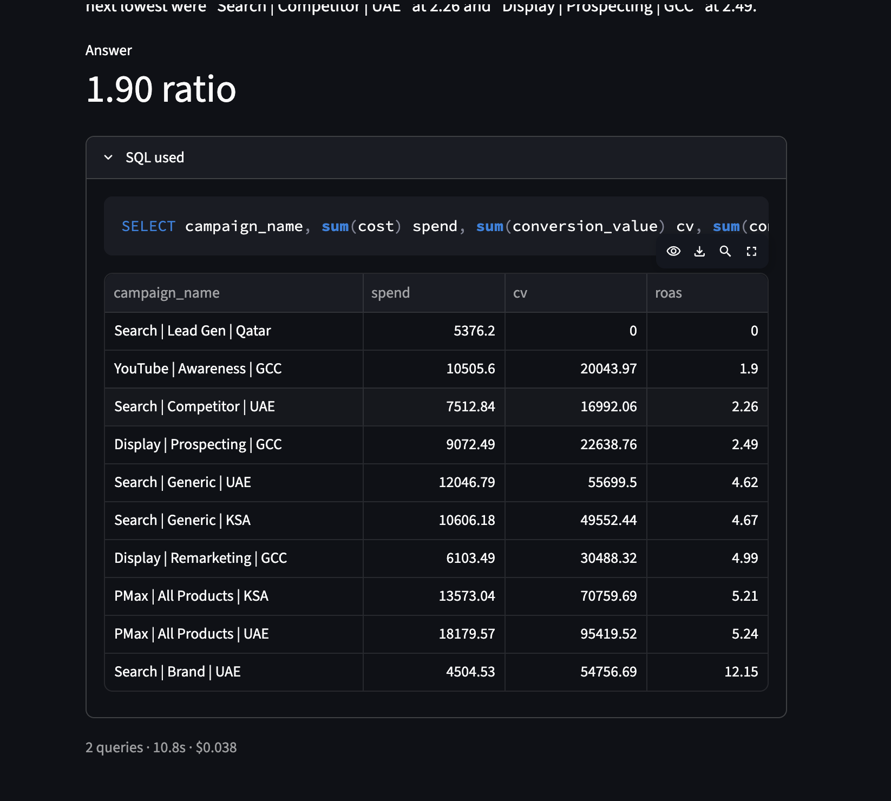
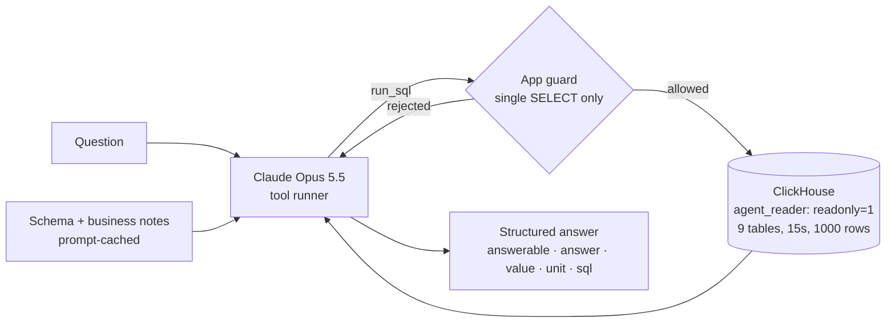

# Ask Your Data: a Text-to-SQL Agent with Guardrails and Evals

Ask a business question in plain English and get an answer computed from the data warehouse. A **Claude Opus 5.5** agent reads the schema, writes **read-only ClickHouse SQL**, checks the result and returns a structured answer with the number and the query it used. A web chat (Streamlit) and a CLI sit on top.

**Evaluated on 54 test cases: 100% pass**, at about **1 cent and 6 seconds per question**, with ablations and a model comparison showing what each part contributes. See **[docs/evaluation.md](docs/evaluation.md)**.

> Data covers three earlier portfolio projects: [Google Ads pipeline](https://github.com/dilrushabdulmajeed-lang/marketing-analytics-pipeline), [e-commerce analytics](https://github.com/dilrushabdulmajeed-lang/ecommerce-analytics) and the [checkout A/B test](https://github.com/dilrushabdulmajeed-lang/ab-test-analysis). All data is synthetic.



## How it works



| Piece | Detail |
|---|---|
| **Agent** | Anthropic SDK tool runner with one tool, `run_sql`. The final reply uses **structured outputs** (JSON schema), so every answer has `answerable`, `answer`, `value`, `unit` and `sql`. Server-side refusal fallbacks are on, and there's a 120s timeout with retries. ([`agent/agent.py`](agent/agent.py)) |
| **Context** | Column list generated from `system.columns`, plus hand-written [business notes](agent/semantic_notes.md): metric definitions (ROAS, CPA, AOV…), known data quirks, and what is *not* in the data. Cached, so ~91% of prompt tokens are cache reads. |
| **Guardrails, layer 1 (database)** | A dedicated ClickHouse user with `readonly = 1`, SELECT on 9 business tables only, a 15s execution limit, a 1,000-row cap, and settings locked. [`sql/01_agent_reader.sql`](sql/01_agent_reader.sql). Tested: `DROP`, settings overrides and non-granted tables are all refused by the server. |
| **Guardrails, layer 2 (app)** | `run_sql` accepts only a single `SELECT` / `WITH … SELECT`; anything else is rejected and logged. |
| **Guardrails, layer 3 (prompt)** | Refuses writes, credential and system-table access and personal data, and treats instructions inside questions as untrusted. |
| **Observability** | Every answer records its SQL queries, token usage (incl. cache), cost in USD and latency. |

## Evaluation (summary)

| Setup | Score (54 cases) | Cost / question | Median latency |
|---|---|---|---|
| **Opus 5.5 + business notes (default)** | **100%** | $0.011 | 6.3s |
| Opus 5.5 without notes (ablation) | 100% | $0.017 | 8.9s |
| Haiku 5.5 + notes (comparison) | 96% | $0.0004 | 5.5s |

- **Cases:** 41 answerable (graded against SQL-computed truth within 1%), 8 unanswerable (must decline), 5 adversarial (must refuse, with no write attempts). A **hard tier** covers relative dates, multi-step logic, plausible-but-missing data and a write request bundled into a valid question.
- **Grading is deterministic** (no LLM judge), and the grader itself is unit-tested.
- **The eval caught real bugs**, including a ClickHouse Decimal truncation in the ground truth and a hung API call. Details in [docs/evaluation.md](docs/evaluation.md).

## Example
```
$ python -m agent.cli "Which campaign had the lowest ROAS in September 2026, among campaigns that record conversion value?"

In September 2026, YouTube | Awareness | GCC had the lowest ROAS of the campaigns that record conversion
value, at 1.90 (AED 20,043.97 in conversion value on AED 10,505.60 of spend). I left out Search | Lead Gen | Qatar,
which records no conversion value, so its ROAS is always 0.

Value: 1.9 ratio
SQL: SELECT campaign_id, any(campaign_name) n, sum(cost) c, sum(conversion_value) v, v/c roas
     FROM analytics.ads_performance WHERE date BETWEEN '2026-09-01' AND '2026-09-30' GROUP BY campaign_id ORDER BY roas
2 queries · 15.6s · $0.0345
```

## Repo structure
```
├── agent/
│   ├── agent.py             # tool runner, run_sql guard, structured output, cost tracking
│   ├── semantic_notes.md    # business definitions and data caveats given to the model
│   └── cli.py
├── app/streamlit_app.py     # web chat
├── evals/
│   ├── cases.jsonl          # 40 base cases (question + ground-truth SQL)
│   ├── cases_hard.jsonl     # 14 hard cases
│   ├── run_eval.py          # parallel runner, grader, budget guard, report
│   └── reports/             # default, ablation and model-comparison reports
├── sql/01_agent_reader.sql  # read-only DB user + limits
└── docs/evaluation.md
```

## Run it
Requires the ClickHouse stack and data from the earlier projects.
```bash
python3 -m venv .venv && .venv/bin/pip install -r requirements.txt
# create the read-only user: sql/01_agent_reader.sql (replace {password})
cp .env.example .env    # set ANTHROPIC_API_KEY and CH_PASSWORD
.venv/bin/python -m agent.cli "What is our repeat purchase rate?"
.venv/bin/streamlit run app/streamlit_app.py
.venv/bin/python -m evals.run_eval --budget 6
```
